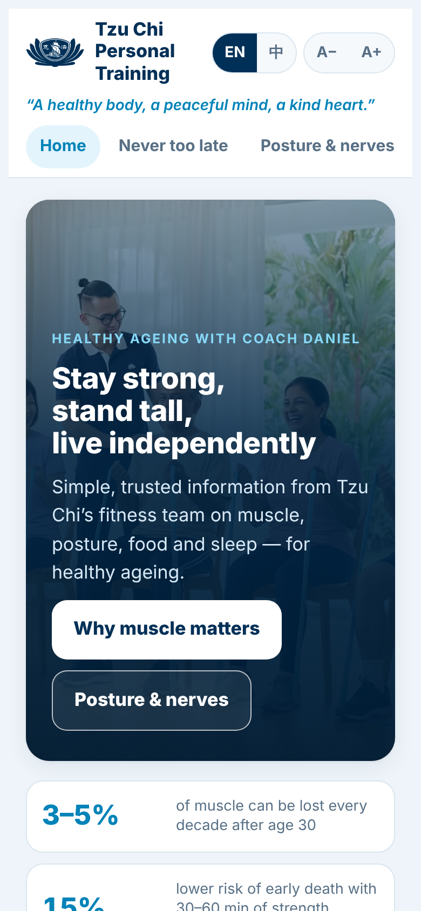
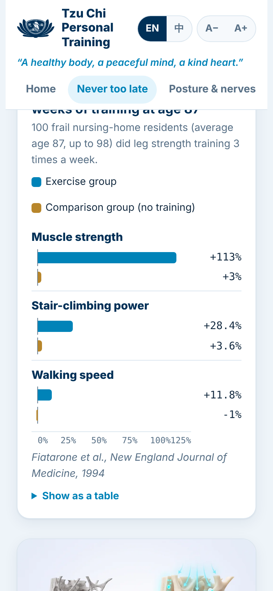
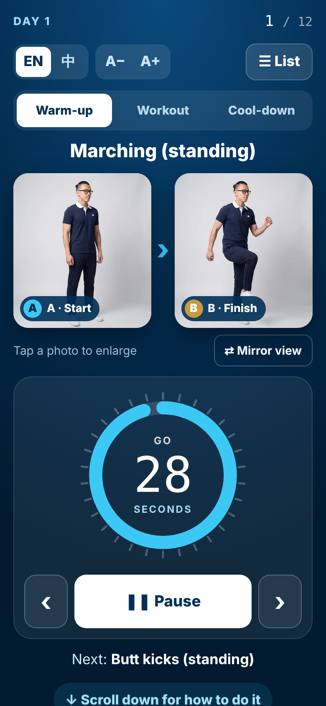
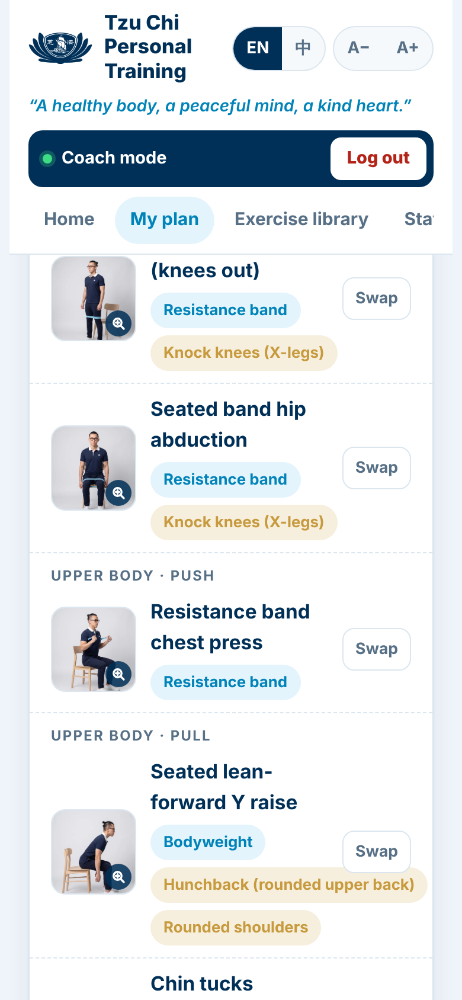
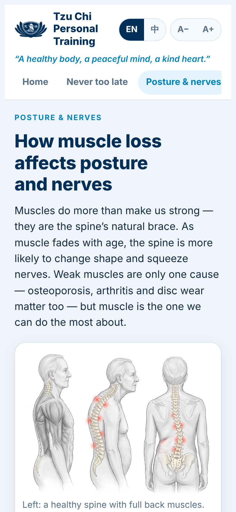
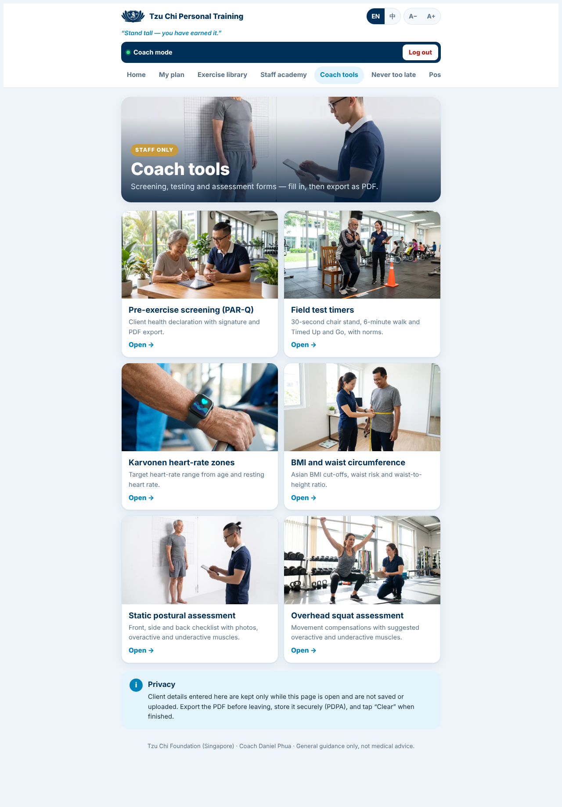
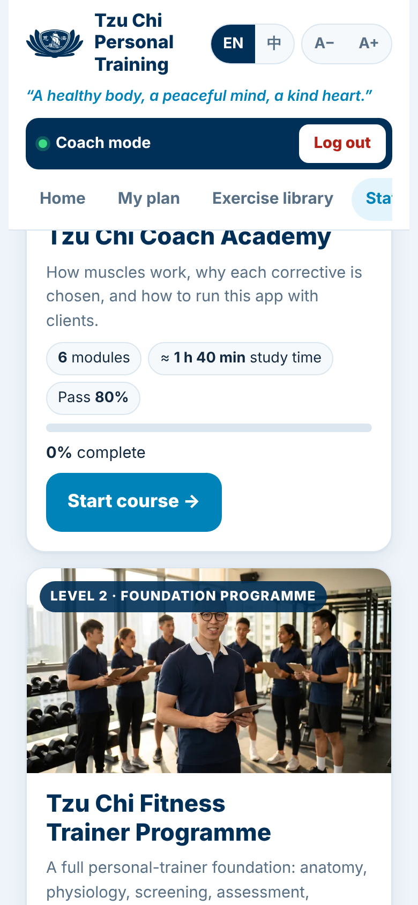
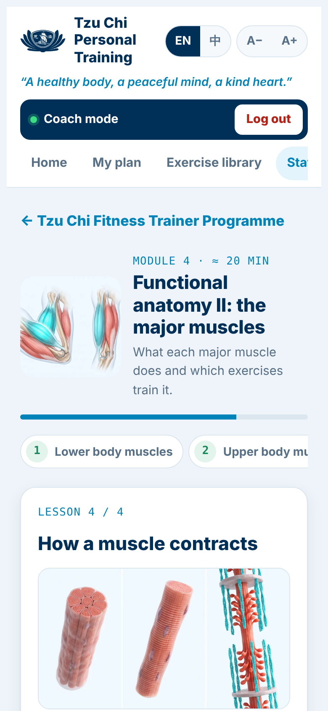
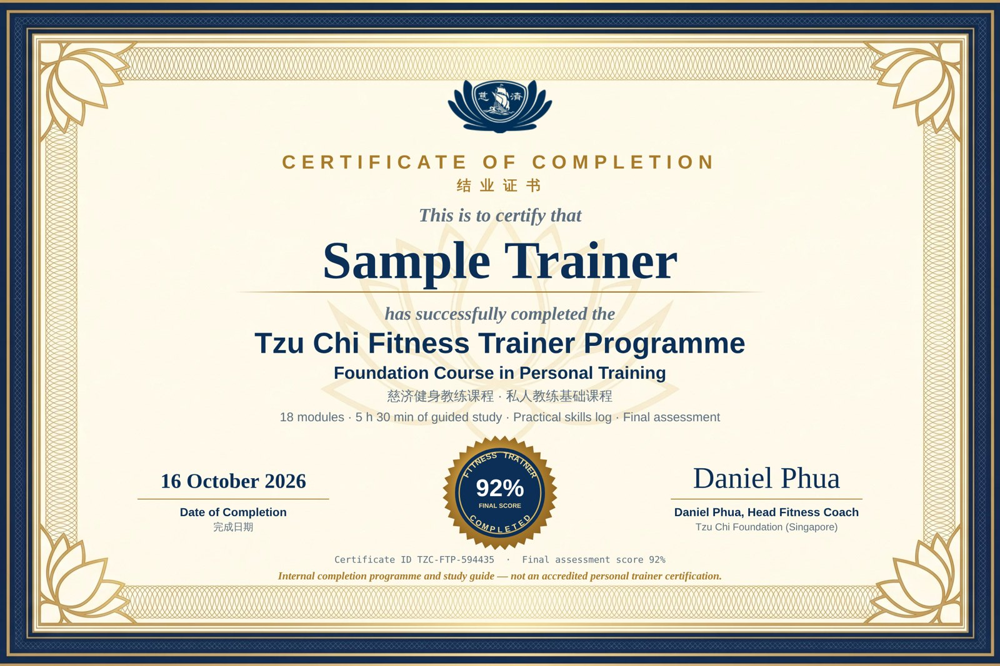

# Tzu Chi Personal Training · 慈济私人训练

**Stay strong, stand tall, live independently.**
A bilingual (English / 中文) strength-training web app for older adults by **Tzu Chi Foundation (Singapore)**, with a staff-only Coach Academy and Fitness Trainer Programme.

🔗 **Live app:** https://tzuchi-singapore.github.io/Personal-Trainer-App-for-CSF-1-5-with-Staff-Academy/

  
  
  

> ⚠️ **Not a medical tool.** This app gives general exercise guidance only. Consult a doctor or physiotherapist before starting any exercise programme. Stop immediately if you feel sharp pain, chest pain, dizziness or unusual breathlessness. In an emergency call **995**.

---

## What’s inside

### For everyone (public pages)
| Page | What it covers |
|---|---|
| **Home** | Why muscle matters, the benefits of strength training, food and protein (Normal / Vegetarian toggle with a protein calculator), sleep, and how muscle loss affects posture |
| **Never too late** | Research showing muscle and bone can still grow in later life — charts drawn from published trials, the timeline of change, and real stories |
| **Posture & nerves** | How weak muscles contribute to hunched back, degenerative scoliosis, forward-head posture and pinched nerves, with red-flag warnings |
| **Safety** | Health Promotion Board-based guidance, the pain-stop rule and the not-medical disclaimer |

### For coaches (staff login)
- **Plan builder** — choose Healthy or Clinical Frailty Scale (CFS) 1–5, posture issues (rounded shoulders, hunchback, knock knees, bow legs) and equipment (bodyweight, band, dumbbell). The app builds a balanced **3-day plan** (Day 1 / 2 / 3), dosed by CFS level.
- **Exercise library** — 80+ exercises with A (start) and B (finish) photos of Coach Daniel, mirror view, step-by-step instructions, target muscles and coaching tips.
- **Big-photo workout player** — large A/B photos with the timer right underneath, 30-second warm-ups and seated cool-downs, set and rest timers, written instructions, swap rules (same muscle group, no repeats), the “Pain? Stop” button and motivation messages. Completing a workout needs at least 3 exercises and offers a phone-calendar reminder.
- **Posture correctives** — weak vs tight muscles with anatomy pictures and a simple-words toggle.

  
  

### Coach tools (staff only)
| Tool | What it does |
|---|---|
| **Pre-exercise screening (PAR-Q)** | Client health questionnaire adapted from the PAR-Q+ general questions, plus falls, pregnancy and surgery, with on-screen signature and PDF export |
| **Field test timers** | 30-second chair stand (CDC STEADI norms), 6-minute walk (lap counter, minute prompts, Enright & Sherrill predicted distance) and Timed Up and Go stopwatch |
| **Karvonen heart-rate zones** | Target heart-rate range from age and resting heart rate, with beta-blocker caution |
| **BMI and waist circumference** | Asian BMI cut-offs, waist risk and waist-to-height ratio |
| **Static postural assessment** | Front / side / back checklists with photos, suggested overactive and underactive muscles, editable notes |
| **Overhead squat assessment** | Movement compensation checklist with suggested overactive and underactive muscles, editable notes |

Every tool exports a branded PDF report. Client details are **not saved** in the app; export the PDF and store it securely.

### Staff Academy (staff only)
| Course | Content | Time |
|---|---|---|
| **Level 1 · Tzu Chi Coach Academy** | 6 modules: using the app, screening and dosage, how muscles work, upper-body and lower-body posture correction, coaching seniors. Quizzes, final exam, certificate. | ≈ 1 h 40 min |
| **Level 2 · Tzu Chi Fitness Trainer Programme** | 18 modules in 6 units, structured like recognised personal-trainer curricula (NCSF, NASM, ACE, NSCA): anatomy, physiology, biomechanics, screening, assessment, programme design, technique, cardio, flexibility, power and plyometrics, nutrition, weight management, special populations and professional practice. 12-item practical skills log, 46-question final exam, certificate. | ≈ 5 h 30 min + practical log |

Certificates show the trainer’s name, score and completion date and can be downloaded as **PDF** or **PNG**.

> 📜 Academy certificates are **certificates of completion for internal training and reference only**. They are **not accredited professional certifications**. To practise as a certified personal trainer, obtain an accredited certification (e.g. NCCA-accredited) and keep CPR/AED current.

  
  

---

## Using the app
- Open the live link on any phone, tablet or computer — no installation or account needed.
- Switch **EN / 中** and text size **A− / A+** at the top (also available inside the workout player).
- **Staff:** ask the Head Fitness Coach for staff access. Always tap **Log out** in the navy *Coach mode* bar before handing a device to a client.

## Privacy
- Everything runs **in the browser**. Plans, workout history and academy progress are saved **only on that device** (browser local storage) and are never uploaded.
- Clearing the browser or changing device resets the data.
- The staff login hides coach tools from the public view; it is a convenience lock, **not** secure authentication. Do not enter confidential client information into the app.

## Technical notes
- **Single self-contained file:** `index.html` contains all code, styles and images (embedded), so it works on GitHub Pages with no build step or server.
- No frameworks or tracking. Fonts are loaded from Google Fonts (Open Font License); the app still works with system fonts offline.
- `.nojekyll` tells GitHub Pages to serve the file as-is.
- `docs/` holds README screenshots and the link-preview image.

### Deploying / updating
1. Replace `index.html` with the new build and commit to `main`.
2. GitHub Pages (Settings → Pages → *Deploy from a branch* → `main` / root) republishes automatically within a minute or two.

## Content and sources
Exercise guidance follows recognised sources including the Singapore Physical Activity Guidelines, HealthHub / Health Promotion Board, WHO 2020 guidelines and ACSM recommendations. Research figures on the *Never too late* page are summarised from published studies (e.g. Fiatarone 1990 & 1994, Watson 2018 LIFTMOR, Katzman 2017 SHEAF, Sinaki 2002); links are listed inside the app. The Fitness Trainer Programme structure follows the published exam outlines of NCSF, ACE, NASM and NSCA.

All photos and illustrations were AI-generated for this app (Higgsfield) and are for illustration only. Charts are drawn by the app from published figures; written content is original.

## Credits
Created for **Tzu Chi Foundation (Singapore)** under the *Anytime Anywhere Anyone Fitness* programme, led by **Coach Daniel Phua**, Head Fitness Coach.

## Licence
© 2026 Tzu Chi Foundation (Singapore). All rights reserved — see [LICENSE](LICENSE).
